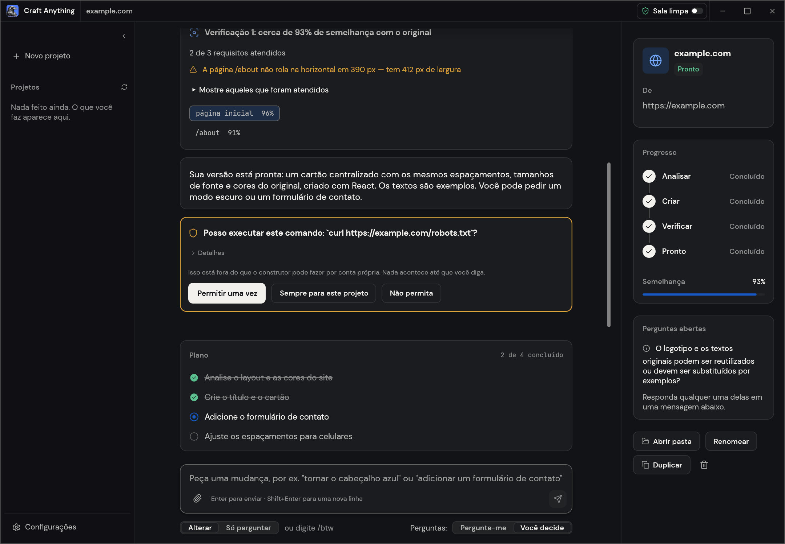
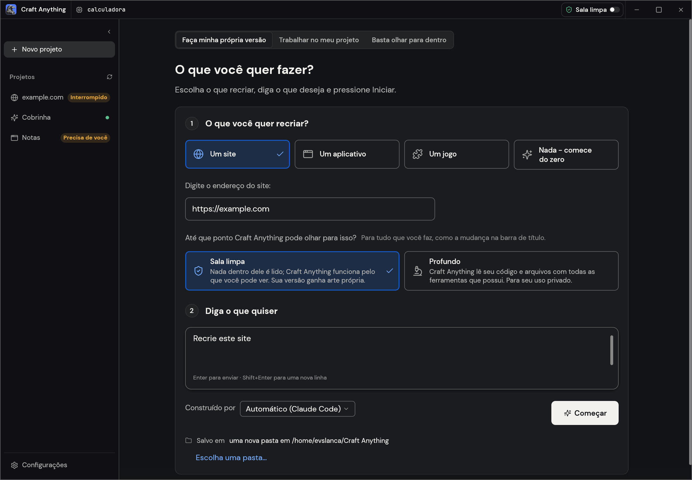
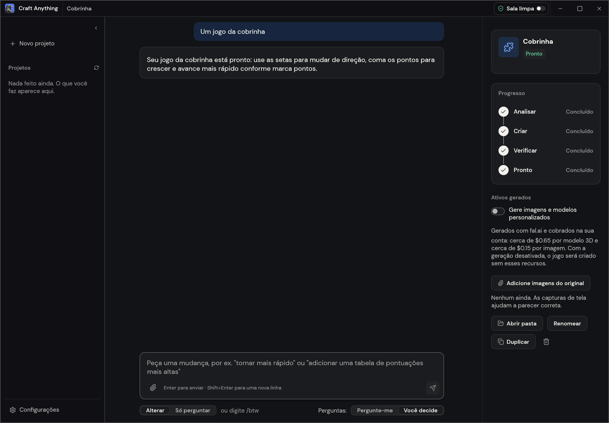
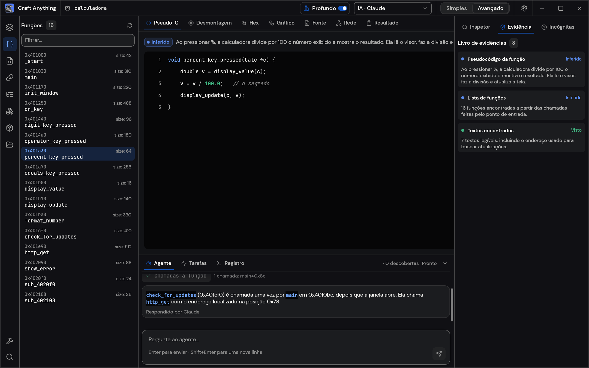

<p align="center">
  <a href="https://getartcraft.com/">
    <picture>
      <source media="(prefers-color-scheme: dark)" srcset="docs/brand/artcraft-logo-white.svg">
      
    </picture>
  </a>
</p>

<p align="center">
  
</p>

<h1 align="center">Craft Anything</h1>

<p align="center">
  <b>Português (Brasil)</b> · <a href="README.en.md">English</a> · <a href="README.ja.md">日本語</a> · <a href="README.zh.md">简体中文</a> · <a href="README.ko.md">한국어</a>
</p>

<p align="center">
  <b>Entenda como qualquer site, aplicativo ou jogo funciona e peça à IA para criar uma versão própria: uma ferramenta de código aberto, feita inteiramente em Rust e com modo de sala limpa.</b><br>
  Aponte para um alvo, descreva o que deseja e a ferramenta analisa o original com recursos reais de inspeção,<br>
  pede a um agente de programação que crie um projeto novo, compara o resultado com o original e o aprimora.
</p>

<p align="center">
  
  
  
  
</p>

<p align="center">
  <a href="https://discord.gg/artcraft"></a>
</p>

<p align="center">
  <a href="#downloads"><b>Baixar Craft Anything</b></a> ·
  <a href="https://getartcraft.com/">ArtCraft</a> ·
  <a href="https://getartcraft.com/apps">Todos os aplicativos da ArtCraft</a>
</p>

<br>

<p align="center">
  
  <br>
  <sub>Projeto de site: cada verificação mostra o quanto o resultado se parece com o original; você aprova ações fora das regras; e o plano indica o que falta.</sub>
</p>

> [!NOTE]
> **A ArtCraft é uma comunidade para artistas de todos os estilos e experiências.** Pintores, fotógrafos,
> cineastas, ilustradores, designers, animadores, pessoas que criam por hobby e até quem pegou um lápis
> pela primeira vez na semana passada. Se você cria, faz parte da comunidade. **[Venha conversar com a gente no Discord](https://discord.gg/artcraft).**

<p align="center">
  <a href="#how-it-works">Como funciona</a> ·
  <a href="#two-ways-to-use-it">Duas formas de usar</a> ·
  <a href="#ai">IA</a> ·
  <a href="#built-for-agents">Agentes</a> ·
  <a href="#under-the-hood">Por dentro</a> ·
  <a href="#get-started">Começar</a> ·
  <a href="#status">Status</a> ·
  <a href="#downloads">Downloads</a> ·
  <a href="https://discord.gg/artcraft">Discord</a>
</p>

<br>

<table>
  <tr>
    <td width="25%" valign="top">
      <h3>🔍 Analise qualquer coisa</h3>
      Sites, aplicativos para computador e celular, jogos e arquivos: ferramentas de inspeção mostram como são feitos e o que fazem, com evidências para cada resposta.
    </td>
    <td width="25%" valign="top">
      <h3>🛠️ Crie a sua própria versão</h3>
      Descreva o que deseja (por exemplo, “Recrie este site” ou “Recrie em Rust a jogabilidade deste jogo”) e um agente de programação cria um projeto novo com as tecnologias que você escolher.
    </td>
    <td width="25%" valign="top">
      <h3>✅ Verificado com evidências</h3>
      Cada projeto criado é comparado com o original — páginas em três larguras de tela, autoteste do jogo ou execução do aplicativo — e refinado até ficar semelhante.
    </td>
    <td width="25%" valign="top">
      <h3>🤖 Preparado para agentes</h3>
      São 320 ferramentas, cada uma disponível como comando da CLI e ferramenta MCP. Assim, qualquer agente pode usar o mesmo mecanismo do aplicativo. Não é preciso usar IA para analisar um alvo.
    </td>
  </tr>
</table>

<br>

<a id="how-it-works"></a>
## Como funciona

Aponte o Craft Anything para um alvo, descreva o que deseja e clique em **Iniciar**. O trabalho passa por
quatro etapas. Quando uma decisão depende de você, o aplicativo pergunta em linguagem simples:

1. **Analisar:** examina o original: páginas em diferentes larguras, código, arquivos e execução.
2. **Criar:** um agente de programação cria um projeto na linguagem, framework ou engine que você pediu,
   ou escolhe uma opção adequada quando você não especifica uma.
3. **Verificar:** compara o projeto com o original e lista o que ainda precisa ser ajustado.
4. **Pronto:** abre ou mostra o resultado. Você também pode pedir mudanças para que o agente o refine.

<table>
  <tr>
    <td width="50%" valign="top">
      <br>
      <sub><b>Criar:</b> escolha o que recriar, descreva o resultado e clique em Iniciar.</sub>
    </td>
    <td width="50%" valign="top">
      <br>
      <sub><b>Pronto:</b> jogue ou peça mudanças no campo abaixo.</sub>
    </td>
  </tr>
</table>

<a id="two-ways-to-use-it"></a>
## Duas formas de usar

- **Simples** (padrão): responda “O que você quer criar?”. Escolha um site, aplicativo ou jogo, descreva-o
  e clique em **Iniciar**. A página do projeto mostra as etapas (Analisar → Criar → Verificar → Pronto),
  explica o que o agente está fazendo, reúne perguntas e pedidos de aprovação, indica a semelhança do resultado
  e oferece atalhos para abrir o projeto ou a pasta. Você pode pedir mudanças no campo ao final da página.
  A opção “Só quero analisar” permite explorar um alvo e fazer perguntas sem criar nada (no modo Profundo).
- **Avançado:** um ambiente completo com ferramentas, funções, strings, pseudo-C, desassemblagem,
  visualização hexadecimal, grafos de chamadas, evidências, dúvidas, tarefas, registros e o console do agente.
  Abra a paleta de ferramentas com `Ctrl/Cmd+K`.

Ambos os modos acionam o mesmo motor.

<a id="clean-room-or-deep"></a>
## Modo Sala limpa ou modo Profundo

- **Sala limpa** (padrão): o aplicativo não lê o código, os arquivos nem o código-fonte do original.
  Ele usa o que é possível observar: imagens que você fornece e, em sites, capturas de tela, textos visíveis,
  medidas de layout, cores, fontes, espaçamentos e menus abertos. Se você permitir, também pode capturar
  a janela de um aplicativo. Ferramentas que acessariam o conteúdo interno são bloqueadas e explicam como
  ativar o modo Profundo.
- **Profundo:** para uso privado, o Craft Anything pode ler o código e os arquivos de um programa com seus
  mecanismos integrados e, se estiver instalado, o Ghidra. Também pode ler o JavaScript de um site e observar
  sua página inicial. O agente de criação pode usar essas informações.

**Sala limpa é uma regra sobre o que o Craft Anything oferece e recusa. Ela não é um sandbox do sistema operacional e não isola seu computador.** Um agente de programação executado por você continua agindo com as permissões da sua conta; o que ele pode ler, gravar ou executar depende dessas permissões. A capacidade do Craft Anything de recusar ferramentas próprias do agente varia conforme o agente. Para as ferramentas do Claude Code em conversas e perguntas, consulte [docs/claude-code.md](docs/claude-code.md).

Alterne os modos na barra de título ou em **Configurações**. Também é possível usar `settings_set deep_mode true`
ou passar `--deep` (ou `--clean-room`) em uma única execução pela CLI.

<p align="center">
  
  <br>
  <sub><b>Avançado:</b> funções, pseudo-C, o agente e a evidência por trás de cada resposta.</sub>
</p>

<a id="ai"></a>
## IA

Para criar projetos, é necessário ter um agente de programação no computador. O **Claude Code** tem suporte
prioritário: o Craft Anything executa o programa `claude` original e usa a sua autenticação. O aplicativo
nunca acessa nem controla sua conta; o uso segue os termos que você aceitou com a Anthropic. Consulte
[docs/claude-code.md](docs/claude-code.md) para entender a integração. Há também um adaptador para Codex,
mas ele ainda não foi validado em uma instalação real.

O **GitHub Copilot** funciona pela CLI instalada, usando ACP; autentique-se separadamente com `copilot login`.
Outros agentes compatíveis com ACP — Gemini CLI, Qwen Code, opencode, goose, Hermes e Maki — podem ser
selecionados por backend. Até agora, apenas o Maki foi executado ao vivo. Para perguntas e análises, há suporte
a Anthropic, OpenAI, OpenRouter e servidores locais compatíveis com a API da OpenAI (**Configurações → IA**).

<a id="built-for-agents"></a>
## Criado para agentes

Cada ferramenta também pode ser chamada como subcomando da CLI ou ferramenta MCP. Assim, um agente pode
analisar um alvo ou executar uma reconstrução completa sem abrir o aplicativo:

```sh
craft-anything-cli commands                                   # lista as ferramentas por grupo
craft-anything-cli mcp                                        # disponibiliza as ferramentas para clientes MCP
craft-anything-cli rebuild https://example.com "Recrie este site"
```

Os resultados incluem evidências, nível de confiança, cobertura e limitações. Resultados extensos começam
com um resumo e podem ser consultados em páginas com `core_evidence_browse`. O comando
`craft-anything-cli setup` conecta o Craft Anything a aplicativos de agentes de programação.

<a id="under-the-hood"></a>
## Por dentro

O projeto é um mecanismo de engenharia reversa escrito em Rust, com 320 ferramentas: 300 no núcleo e as
demais nas camadas de IA e configuração. Ele analisa programas nativos, .NET, Java, Android, Apple,
Electron/JavaScript, sites, firmware, capturas de pacotes, bancos de dados e arquivos de jogos. Seus
decodificadores, desassemblador e descompilador funcionam sem programas externos; no modo Profundo, também
é possível usar o Ghidra, quando instalado. O mesmo núcleo atende o aplicativo desktop (egui), a CLI e o
servidor MCP. Parte dele também roda no navegador como WebAssembly. A lista completa está em
[docs/tools.md](docs/tools.md).

<a id="get-started"></a>
## Comece

Requer Rust **1.97 ou mais recente** (uma dependência precisa disso; `rustup update`). No Debian ou Ubuntu,
o aplicativo de desktop também precisa de:

```sh
sudo apt-get install libxkbcommon-dev libwayland-dev libx11-dev libxrandr-dev libxi-dev libgl1-mesa-dev libgtk-3-dev
```

Então:

```sh
git clone https://github.com/storytold/craft-anything && cd craft-anything
cargo run --release -p craft-anything                # inicia o aplicativo desktop
cargo install --path apps/craft-anything-cli         # instala a CLI como `craft-anything-cli`
craft-anything-cli doctor                            # verifica a instalação, os agentes e as engines
```

Para criar projetos, conecte um agente de programação ao computador (consulte [IA](#ai)). O comando `doctor`
informa o que falta. Você também pode iniciar uma reconstrução pela linha de comando; as perguntas aparecem
no terminal:

```sh
craft-anything-cli rebuild https://example.com "Recrie este site"
craft-anything-cli rebuild - "Crie um jogo de cobrinha em Rust" --rounds 1
craft-anything-cli rebuild https://example.com "Deixe o cabeçalho azul" --continue-in "<project folder>"
craft-anything-cli rebuild - "Adicione um formulário de contato" --project-folder "<your folder>" --existing edit
```

Por padrão, projetos novos ficam em `Documents/Craft Anything`; você pode mudar a pasta em
**Configurações → Geral**. Cada projeto contém `craft.json` (pedido, alvo, status e histórico), `capture/`
(dados coletados do alvo), `app/` (projeto criado), `checks/` (comparações com o original),
`investigation.cany/` (evidências) e `inbox/` (perguntas em aberto).

Você também pode iniciar um projeto em uma pasta escolhida por você (**Escolher uma pasta…** na tela
Iniciar ou com `--project-folder`). Se ela já tiver arquivos, indique se são o próprio aplicativo, que o
agente editará no local, ou material de referência, ao lado do qual o projeto será criado em `app/`.
Essa preferência pode ser lembrada em **Configurações → Geral**. A mesma tela permite listar projetos
de outras pastas; remover um projeto da lista não apaga seus arquivos.

## Status

> [!IMPORTANT]
> **Status:** o Craft Anything está em alfa inicial. Veja o que funciona, o que está parcial e o que vem a seguir:
>
> - **Funciona hoje:** aplicativo desktop (modos Simples e Avançado), CLI e servidor MCP; fluxo
>   Analisar → Criar → Verificar → Refinar para sites, aplicativos e jogos com Claude Code; verificações
>   de sites em três larguras; criação de jogos em Unity, Unreal ou Godot; modo Profundo com Ghidra;
>   geração opcional de imagens e modelos 3D com sua própria chave da fal.ai; plugins MCP e componentes
>   WASM nas compilações que ativam `wasm-plugins`.
> - **Parcial:** criação com chaves de API e outros agentes de programação (implementada, mas ainda sem
>   execução ao vivo); verificações de comportamento de aplicativos e jogos; algumas ferramentas de engine
>   testadas apenas com implementações substitutas.
> - **Lançamentos:** instaladores alfa para Windows, macOS, Linux e FreeBSD estão na
>   [página de versões](https://github.com/storytold/craft-anything/releases).
> - **Próximo:** o plano gerenciado.
>
> [docs/STATUS.md](docs/STATUS.md) detalha o estado e a verificação de cada parte;
> [docs/tool-status.md](docs/tool-status.md) traz o status de cada ferramenta; e
> [docs/ROADMAP.md](docs/ROADMAP.md) apresenta os próximos passos. Relate problemas ou conte o que
> não funcionou no [Discord](https://discord.gg/artcraft).

**Uso responsável.** Use o Craft Anything somente em softwares que você possui ou tem autorização para
examinar. O aplicativo não burla DRM, autenticação nem sistemas anti-cheat. As reconstruções reproduzem
layout, estilo e comportamento com base nas evidências. O agente não deve copiar logotipos, imagens ou textos
sem sua confirmação de que você é o titular ou tem permissão para usá-los.

**Instalar dependências executa código.** Ao instalar as dependências de um projeto, os comandos rodam no seu computador, e os pacotes podem executar código durante a instalação. O npm executa por padrão os scripts de instalação dos pacotes; scripts de compilação do Rust e pacotes Python de código-fonte também executam seu próprio código de configuração. O Craft Anything pede confirmação antes de executar um tipo de comando que ainda não conhece naquele projeto (`npm`, `cargo`…). Ao escolher “sempre permitir” para `npm`, os comandos npm seguintes rodam sem nova pergunta; use essa opção apenas em projetos cujas dependências você confia. Para instalar pacotes npm sem executar os scripts de instalação, use `npm install --ignore-scripts`.

## Downloads

No GitHub, a [versão mais recente](https://github.com/storytold/craft-anything/releases/latest) reúne os downloads abaixo. A página de [todas as versões](https://github.com/storytold/craft-anything/releases) também inclui versões anteriores e suas notas. `<ver>` representa o número da versão nos nomes dos arquivos; `SHA256SUMS.txt` lista o hash SHA-256 de cada arquivo.

### Windows

| Compilação | Instalador | Portátil |
|---|---|---|
| x64 (Intel/AMD de 64 bits) | `craft-anything-<ver>-windows-x64.msi` | `craft-anything-<ver>-windows-x64-portable.zip` |
| arm64 (Snapdragon e outros PCs ARM) | `craft-anything-<ver>-windows-arm64.msi` | `craft-anything-<ver>-windows-arm64-portable.zip` |
| x86 (32 bits) | `craft-anything-<ver>-windows-x86.msi` | `craft-anything-<ver>-windows-x86-portable.zip` |

Os instaladores e executáveis têm assinatura digital de código. Na versão portátil, as configurações ficam na mesma pasta do aplicativo.

### macOS

| Produto | Arquivo | Observações |
|---|---|---|
| Aplicativo universal (Apple Silicon e Intel) | `craft-anything-<ver>-macos-universal.dmg` | Assinado e notarizado pela Apple |
| Ferramenta de linha de comando universal | `craft-anything-cli-<ver>-macos-universal.zip` | Assinada e notarizada; veja abaixo se o macOS bloquear o arquivo |

As versões posteriores à 0.2.0 já incluem a CLI no aplicativo. O ZIP separado só é necessário se você
quiser usar a linha de comando sem instalar o aplicativo.

Ao baixar o ZIP pelo navegador, o macOS pode exibir “A Apple não conseguiu verificar o craft-anything-cli”.
Como um executável isolado não carrega sua notarização, o macOS precisa consultá-la online. Esse aviso não
se aplica ao download feito pelo terminal. Nesse caso, use:

```sh
ver=0.2.0   # altere para a versão desejada
curl -fLO "https://github.com/storytold/craft-anything/releases/download/v$ver/craft-anything-cli-$ver-macos-universal.zip"
ditto -x -k "craft-anything-cli-$ver-macos-universal.zip" .
mkdir -p ~/.local/bin
mv "craft-anything-cli-$ver-macos-universal/craft-anything-cli" ~/.local/bin/
~/.local/bin/craft-anything-cli --version
```

Para executá-lo apenas como `craft-anything-cli`, adicione `~/.local/bin` ao seu `PATH`.

Se você já baixou uma cópia bloqueada, clique em **Concluído** (não em **Mover para o Lixo**) e execute
`xattr -d com.apple.quarantine <path to craft-anything-cli>`, ou autorize a abertura em **Ajustes do Sistema →
Privacidade e Segurança → Abrir Mesmo Assim**.

#### Como verificar a assinatura e a notarização de um download no macOS

Todas as versões para Mac são assinadas com um certificado Developer ID e notarizadas pela Apple. Para
verificar um download, execute estes comandos no Terminal (substitua `<ver>` pela versão e ajuste os caminhos):

```sh
# Imagem de disco: "accepted" e "source=Notarized Developer ID" indicam que passou
spctl --assess --type open --context context:primary-signature -v "craft-anything-<ver>-macos-universal.dmg"
# O ticket de notarização está anexado: imprime "The validate action worked!"
xcrun stapler validate "craft-anything-<ver>-macos-universal.dmg"

# O aplicativo, depois de abrir a imagem de disco: a assinatura precisa ser válida
codesign --verify --deep --strict --verbose=2 "/Volumes/<disk image name>/Craft Anything.app"
spctl --assess --type execute --verbose "/Volumes/<disk image name>/Craft Anything.app"

# A ferramenta de linha de comando: um executável isolado não leva o ticket; o macOS o verifica online
codesign --verify --strict --verbose=2 ~/.local/bin/craft-anything-cli
codesign -dv --verbose=4 ~/.local/bin/craft-anything-cli 2>&1 | grep Authority
```

As linhas `Authority` devem mencionar um certificado “Developer ID Application”. Se alguma verificação
falhar, não execute o arquivo; informe a saída e a tag da versão.

### Linux

| Formato | x86_64 | aarch64 (ARM64) | Notas |
|---|---|---|---|
| AppImage | `craft-anything-<ver>-linux-x86_64.AppImage` | `craft-anything-<ver>-linux-aarch64.AppImage` | Funciona em qualquer lugar; atualiza-se com [AppImageUpdate](https://github.com/AppImageCommunity/AppImageUpdate) (arquivos `.zsync`) |
| Flatpak | `craft-anything-<ver>-linux-x86_64.flatpak` | `craft-anything-<ver>-linux-aarch64.flatpak` | Em área restrita; `flatpak install --user <file>` |
| Debian/Ubuntu | `craft-anything-<ver>-linux-x86_64.deb` | `craft-anything-<ver>-linux-aarch64.deb` | |
| Fedora/RHEL/openSUSE | `craft-anything-<ver>-linux-x86_64.rpm` | `craft-anything-<ver>-linux-aarch64.rpm` | |
| Tarball | `craft-anything-<ver>-linux-x86_64.tar.gz` | `craft-anything-<ver>-linux-aarch64.tar.gz` | Descompacte em qualquer lugar |

RISC-V (riscv64): `craft-anything-<ver>-linux-riscv64.tar.gz`, somente em arquivo tar.

O AppImage também inclui a CLI: execute `<AppImage> --cli <command>` (por exemplo,
`<AppImage> --cli mcp` para um cliente MCP) ou crie um link para o AppImage chamado
`craft-anything-cli` e execute esse link.

### FreeBSD

| Produto | Arquivo |
|---|---|
| x86_64 | `craft-anything-<ver>-freebsd-x86_64.tar.gz` |

### Web (WebAssembly)

| Produto | Arquivo | Observações |
|---|---|---|
| Visualizador web | `craft-anything-web-<ver>.zip` | Identifica arquivos no navegador sem enviá-los para outro lugar. Hospede a pasta em qualquer servidor web estático ([packaging/web/README.md](packaging/web/README.md)). |

<br>

<p align="center">
  <a href="https://discord.gg/artcraft"></a>
</p>

<h3 align="center">Venha fazer coisas conosco</h3>

<p align="center">
  Nosso Discord reúne artistas de todos os tipos: pessoas que pintam, fotografam, desenham, editam filmes,
  criam projetos gráficos ou ainda estão descobrindo o que gostam de fazer. Compartilhe seu trabalho,
  peça ajuda, conte o que não está funcionando ou diga o que gostaria que essas ferramentas fizessem.
  Seja qual for a sua área ou há quanto tempo você cria, será muito bem-vindo.
</p>

<p align="center">
  <a href="https://discord.gg/artcraft"><b>discord.gg/artcraft</b></a> ·
  <a href="https://getartcraft.com/">getartcraft.com</a> ·
  <a href="https://getartcraft.com/apps">Aplicativos da ArtCraft</a> ·
  <a href="https://github.com/storytold/craft-anything">Craft Anything</a>
</p>

---

## Suíte de aplicativos Craft

| | Aplicativo | Descrição | Código | Saiba mais |
|:-:|---|---|---|---|
|  | **PhotoCraft** | Edição de imagens: camadas, máscaras, tipografia e arquivos PSD | [GitHub](https://github.com/storytold/photocraft) | [Site](https://getartcraft.com/apps/photocraft) |
|  | **VectorCraft** | Ilustração vetorial | [GitHub](https://github.com/storytold/vectorcraft) | [Site](https://getartcraft.com/apps/vectorcraft) |
|  | **FilmCraft** | Edição de vídeo, cor e som | [GitHub](https://github.com/storytold/filmcraft) | [Site](https://getartcraft.com/apps/filmcraft) |
|  | **LightCraft** | Biblioteca de fotos e edição de arquivos RAW | [GitHub](https://github.com/storytold/lightcraft) | [Site](https://getartcraft.com/apps/lightcraft) |
|  | **PdfCraft** | Leitura, organização e proteção de PDFs | [GitHub](https://github.com/storytold/pdfcraft) | [Site](https://getartcraft.com/apps/pdfcraft) |
|  | **EffectCraft** | Animação gráfica e efeitos visuais | [GitHub](https://github.com/storytold/effectcraft) | [Site](https://getartcraft.com/apps/effectcraft) |
|  | **DesignCraft** | Diagramação de páginas e publicação | [GitHub](https://github.com/storytold/designcraft) | [Site](https://getartcraft.com/apps/designcraft) |
|  | **FigCraft** | Design de interface e prototipagem | [GitHub](https://github.com/storytold/figcraft) | [Site](https://getartcraft.com/apps/figcraft) |
|  | **WordCraft** | Processamento de texto e documentos | [GitHub](https://github.com/storytold/wordcraft) | [Site](https://getartcraft.com/apps/wordcraft) |
|  | **SoundCraft** | Gravação e edição de áudio | [GitHub](https://github.com/storytold/soundcraft) | [Site](https://getartcraft.com/apps/soundcraft) |
|  | **DeckCraft** | Apresentações e conjuntos de slides | [GitHub](https://github.com/storytold/deckcraft) | [Site](https://getartcraft.com/apps/deckcraft) |
|  | **CADCraft** | Design auxiliado por computador | [GitHub](https://github.com/storytold/cadcraft) | [Site](https://getartcraft.com/apps/cadcraft) |
|  | **GridCraft** | Planilhas e dados | [GitHub](https://github.com/storytold/gridcraft) | [Site](https://getartcraft.com/apps/gridcraft) |
|  | **TextureCraft** | Pintura de textura 3D | [GitHub](https://github.com/storytold/texturecraft) | [Site](https://getartcraft.com/apps/texturecraft) |
|  | **Craft Anything** | Veja como qualquer software funciona e depois crie o seu próprio | [GitHub](https://github.com/storytold/craft-anything) | [Site](https://getartcraft.com/apps/craft-anything) |
|  | **SolidCraft** | CAD 3D paramétrico da Tangency Labs (aplicativo comunitário) | [GitHub](https://github.com/tangency-labs/solidcraft) | |


## Licença e créditos

O Craft Anything é distribuído sob uma licença dupla: [MIT](LICENSE-MIT) ou [Apache-2.0](LICENSE-APACHE), à sua escolha.
Copyright (c) 2026 ArtCraft Team e colaboradores do Craft Anything. Os avisos obrigatórios estão em [NOTICE](NOTICE).

Fontes, ícones, imagens e outros recursos distribuídos com o aplicativo mantêm suas próprias licenças; cada item,
seu autor, sua origem e sua licença estão relacionados em [ATTRIBUTION.md](ATTRIBUTION.md).

As capturas de tela mostram exemplos de projetos recriados com a ferramenta: example.com, um jogo da cobrinha
e um pequeno programa de calculadora.

O nome ArtCraft, a marca nominativa e os logotipos em [`docs/brand/`](docs/brand/) são marcas registradas da
ArtCraft Team e não estão cobertos por esta licença. Eles só podem ser usados sem modificações e como parte
deste repositório e do Craft Anything, conforme os termos em [`docs/brand/LICENSE-brand.txt`](docs/brand/LICENSE-brand.txt).
Forks e versões modificadas devem removê-los.

<p align="center">
  <a href="https://getartcraft.com/"></a><br>
<sub>Feito pela equipe e comunidade de <a href="https://getartcraft.com/">ArtCraft</a>.</sub>
</p>
